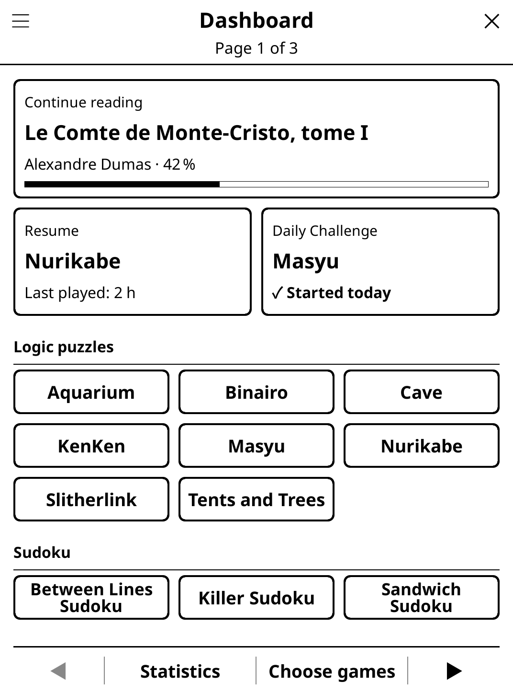

# dashboard.koplugin

A full-screen home screen for [KOReader](https://github.com/koreader/koreader):
pick up your book, resume your game or play today's challenge in one tap.

## Screenshot

## Concept

One screen that answers "what do I do now?" — instead of digging through the
file browser and the Tools menu. It can open by itself when KOReader starts,
and it replaces the former **Startup Menu** plugin (`startmenu.koplugin`),
whose settings it takes over (see [Migrating from Startup Menu](#migrating-from-startup-menu)).

Designed for e-ink: no animation, black on white, thick borders, big tap
targets, one repaint per page.

## Features

- **Continue reading** — the last book you opened (title, author, progress
  bar); one tap reopens it. Hidden when there is no last book or the file is
  gone.
- **Resume** — the game you played most recently, with when you last played.
- **Daily Challenge** — today's puzzle in one of your puzzle games. The game
  changes every day (every game of the pool once before any repeats), or you
  pin one in the settings. A ✓ shows once you have started today's challenge;
  tapping it again reopens the game without regenerating the puzzle.
- **Game grid** — your chosen games as large tiles (2–3 columns depending on
  the screen width), grouped by category (Logic puzzles, Sudoku, Word games,
  Board games, Card & dice games, Classic puzzles, Party & quiz, Other), paged
  with ◀ ▶ or a horizontal swipe (or the page-turn keys).
- **Choose games** — a full-screen list of every installed game, grouped like
  the grid: tap a game to show or hide it, ▲ ▼ to change its place.
- **Statistics** — the former dashboard list: reading history, recent games,
  sessions and play time per game, and quick actions (update plugins, back to
  the library).
- **Portrait and landscape** — in landscape the cards move to a left column
  and the grid takes the rest of the screen.
- **Home-button shortcut** — optionally bind the device home button (while
  reading) to open the dashboard.
- **simpleui homescreen row** — when simpleui is installed, a "Games
  (Dashboard)" module with your recent games and a suggestion.

## Settings

Open **Tools → Dashboard**:

| Setting | Description |
|---------|-------------|
| Open Dashboard | Show the dashboard now |
| Show automatically | **At KOReader launch only** (default), **Every time the file browser opens** (also after closing a book), or **Never**; plus the startup delay (0.5 / 1 / 2 s). It never opens over a book. |
| Choose games | Which games the grid shows, and their order |
| Game order | **Custom order** (set in Choose games) or **Last played first**; **Group by category** on/off |
| Daily Challenge game | **Automatic** (a different game every day) or one game of your choice |
| Home button → Dashboard | While reading, the home button opens the dashboard |

Which games show by default: Sudoku, 2048, Minesweeper and Mastermind plus
your six most recently played games — until you change anything in **Choose
games**, which then fixes the list. A game installed later is hidden unless
it is one of those defaults.

The Daily Challenge is drawn from the games on your dashboard that have a
daily mode (the ones with **Daily Challenge** in their own menu); if none of
them has one, from every installed game that does.

## Migrating from Startup Menu

Startup Menu is retired: its features are part of the dashboard. On its first
start, this version reads `settings/startmenu.lua` once (without changing it):

- the games you had ticked in Startup Menu become the games on the dashboard
  (unless you had already chosen games in the dashboard);
- if you had switched Startup Menu's prompt off — and had not turned on the
  dashboard's own "Show at startup" — the dashboard does not open by itself
  either; otherwise it opens at KOReader launch.

The dashboard's former "Show at startup" checkbox is carried over the same
way (on → at launch, off → never). After that, uninstall Startup Menu, or both
will appear at startup.

## Installation

1. Download `dashboard.koplugin.zip` from the [latest release](../../releases/latest).
2. Extract into the `plugins/` folder of your KOReader data directory.
3. Restart KOReader.

## License

GPL-3.0 — see [LICENSE](LICENSE).
